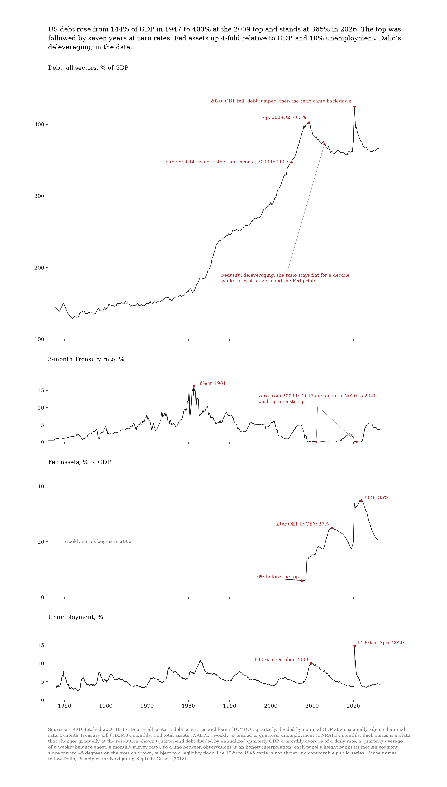

# tufte

A Claude Code skill that makes charts the way Edward Tufte's books say to: show the data, erase the ink that is not data, lie factor of one, labels on the graphic, dense small multiples, one strong color on a grey field, and a sentence that states the finding. It ships the doctrine as operating rules, the references behind them, deterministic checks, and matplotlib implementations of Tufte's own forms.



## Install

As a plugin (recommended; the skill is then `/tufte:tufte`):

```
/plugin marketplace add andrewha-xyz/tufte
/plugin install tufte@andrewha-xyz
```

As a personal skill (then `/tufte`): copy or symlink `skills/tufte` to `~/.claude/skills/tufte`. The skill locates its own scripts through `${CLAUDE_SKILL_DIR}`, so both installs work from the same files.

Scripts run through [uv](https://docs.astral.sh/uv/) with `--locked`; each declares its dependencies inline and ships a lockfile, so nothing else is installed.

## What it does

Three modes, chosen from the request:

- **design** (default): names the comparison, picks the form (line, sparkline, small multiples, table-graphic, quartile plot, dot-dash, sorted dots), runs the integrity pass, erases, layers, verifies with the scripts, generates code from the recipes, and looks at the render.
- **review**: scores an existing chart, image or code against a four-block rubric (integrity, form, ink, polish), findings ordered by severity, each with a rule id and a concrete rewrite.
- **infographic**: builds a Tufte confection, one argument carried by one image with the words integrated.

## Layout

| Path | Role |
|---|---|
| `skills/tufte/SKILL.md` | the twelve rules, three workflows, screen deviations |
| `skills/tufte/references/integrity.md` | lie factor, six principles of graphical integrity, aspect ratio, context, order by cause, Challenger with its caveat, corruption in evidence |
| `skills/tufte/references/data-ink.md` | data-ink ratio, erase and erase-redundant, chartjunk, range-frame, dot-dash-plot, quartile plot, table-graphic |
| `skills/tufte/references/density-multiples.md` | data density, shrink principle, small multiples, sparklines, micro/macro, layering |
| `skills/tufte/references/analytical-design.md` | six principles of analytical design, Snow, smallest effective difference, friendly graphic, slides, confections, color |
| `skills/tufte/references/layout-grid.md` | Müller-Brockmann's grid for charts and dashboards: margins, baseline, columns, fields, caption placement, a dashboard template |
| `skills/tufte/references/review-rubric.md` | scored audit template and output format |
| `skills/tufte/references/recipes.md` | matplotlib, plotly, vega-lite, SVG recipes |
| `skills/tufte/scripts/tufte_mpl.py` | matplotlib theme; forms `range_frame`, `frame`, `dot_dash`, `sparkline`, `slopegraph`, `quartile`; words `headline`, `source`, `note`, `callout`; layout `page` (grid fields, baseline text, overlay); `uv run --locked "skills/tufte/scripts/tufte_mpl.py" demo` renders a self-check |
| `skills/tufte/scripts/lie_factor.py` | lie factor calculator |
| `skills/tufte/scripts/check_contrast.py` | WCAG contrast ratio (from dataink, MIT) |
| `skills/tufte/scripts/check_palette.py` | pairwise CVD-simulated distinguishability (from dataink, MIT) |
| `examples/dalio/` | worked example: Ray Dalio's big debt cycle from FRED data, script, data snapshot, render |

## Example

`examples/dalio/big_debt_cycle.py` draws four stacked small multiples from FRED (all-sector debt to GDP, 3-month Treasury rate, Fed assets to GDP, unemployment, 1947 to 2026) with Dalio's phases annotated on the curve. Run it with `uv run --locked examples/dalio/big_debt_cycle.py`; it writes `big-debt-cycle.rendered.png` in the working directory, and the csv snapshot is included so it reproduces offline. The preview above is the pre-rendered copy.

## Sources and verification

Written from the books, then checked against whatever primary text could be read online. Status per book:

| Book | Used for | Verified against |
|---|---|---|
| The Visual Display of Quantitative Information (1983, 2nd ed. 2001) | graphical excellence (ch. 1); graphical integrity and lie factor (ch. 2: lie factor p. 57, area/volume examples pp. 69 to 71, printed-numbers defense p. 76, six principles p. 77); data-ink (ch. 4: ratio p. 93, five principles p. 105); chartjunk (ch. 5: moire p. 107, grid p. 112, duck p. 116); redesigns (ch. 6: quartile plot pp. 124 to 125, white grid pp. 127 to 129, range-frame p. 130, dot-dash-plot p. 133); table-graphic pp. 158 to 159 (the name slopegraph is from 2011, not VDQI); data density and small multiples (ch. 8: density p. 162, principle p. 168, shrink principle p. 169, multiples p. 170); aesthetics (ch. 9: friendly data graphic p. 183, shape pp. 186 to 190); epilogue p. 191 | full text of the 2nd edition (archive.org, `tufte_visual_display_of_quantitative_information_low-res`); page numbers from the book's own index and footers |
| Envisioning Information (1990) | escaping flatland (ch. 1); micro/macro readings (ch. 2: "to clarify, add detail" p. 37, multifunctioning elements p. 47); layering and separation, 1+1=3 or more after Albers, clutter quote (ch. 3, around pp. 51 to 65); small multiples (ch. 4); color and information (ch. 5: do no harm and four uses p. 81, Imhof rules pp. 82 and 90, grey field p. 83, nature's palette p. 90, red/green footnote p. 92) | ch. 5 against a scan of the chapter; chs. 1 to 4 against course notes only, pages marked "around" are unverified |
| Visual Explanations (1997) | Snow's cholera map and the Challenger decision (ch. 2, pp. 27 to 53); smallest effective difference (ch. 4, p. 73); visual confections (ch. 7, p. 121) | ch. 2 against a scan of the chapter; chs. 4 and 7 against reviews and course pages only. The Challenger caveat cites Robison, Boisjoly, Hoeker and Young 2002 |
| Beautiful Evidence (2006) | sparklines (ch. 2, pp. 46 to 63); fundamental principles of analytical design (ch. 5, p. 122); corruption in evidence presentations (ch. 6, p. 140); the cognitive style of PowerPoint (ch. 7, p. 156); mapped pictures (ch. 1); words, numbers, images (ch. 4) | ch. 2 against Tufte's online version (edwardtufte.com, "Sparkline theory and practice"); ch. 7 and the Columbia material against edwardtufte.com; chs. 5 and 6 against excerpts and secondary summaries, so the six principles are close to Tufte's wording but principle 2 is not verbatim-verified |
| The Cognitive Style of PowerPoint (essay, 2003; 2nd ed. 2006) | low resolution, pitching, the Columbia slide, technical reports over slides | edwardtufte.com notebook entries |

Claims that were in an early draft and removed because no source supports them as Tufte's: "grey is the great harmonizer", an Imhof rule about the color circle, "resolution over sequence" as a phrase, "a page of 11-point type beats twenty slides", "superstition" about zero baselines, the golden ratio as Tufte's default shape.

## Layout

Tufte's chartjunk rule covers dark, dominant gridlines inside a chart; he does not say where the chart goes on the page. For that the skill uses Josef Müller-Brockmann's Grid Systems in Graphic Design (1981): margins, a baseline from the body leading, columns with one gutter, fields, and the rule that every panel, caption and note occupies whole fields. `references/layout-grid.md` has the rules and a dashboard template; `tufte_mpl.page` and the CSS tokens in the recipes implement them.

## Deliberately excluded

Narrative arcs and slide storytelling (Knaflic), KPI tiles and gauges-versus-bullet-graphs (Few), brand font templates, right-to-left typography, WCAG as a legal standard. The two contrast scripts are kept because Tufte's friendly-graphic list names colorblind readers; their thresholds are the modern floor, not Tufte's text.

## Known limits of `tufte_mpl.py`

`slopegraph` assumes a linear y-axis and single-line names, and must be called last on its panel; in a grid, hide every slopegraph panel's axes before the first call. `headline` and `source` wrap by measuring the rendered text and may still overrun by a few pixels in unusual fonts. `note` and `callout` place text where you tell them; choosing empty space and checking the render is the author's job.

## License

MIT. `check_contrast.py` and `check_palette.py` are from [dataink](https://github.com/oh-da/dataink) by Ohad Dahan, MIT, see `skills/tufte/scripts/LICENSE-dataink`.
